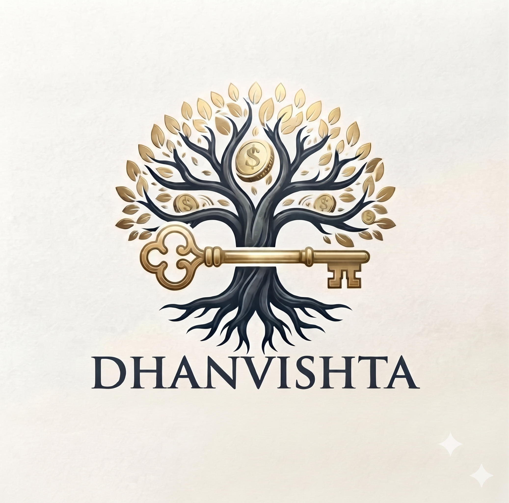

<html lang="en" class="scroll-smooth dark">
<head>
  <meta charset="UTF-8">
  <meta name="viewport" content="width=device-width, initial-scale=1.0, maximum-scale=5.0, viewport-fit=cover">
  <title>Dhanvista | Web, Software & Mobile App Development by Abhishek Kumar</title>
  
  <!-- Inter & Plus Jakarta Sans Fonts -->
  <link rel="preconnect" href="https://fonts.googleapis.com">
  <link rel="preconnect" href="https://fonts.gstatic.com" crossorigin>
  <link href="https://fonts.googleapis.com/css2?family=Plus+Jakarta+Sans:wght@400;500;600;700;800&family=JetBrains+Mono:wght@500;700&display=swap" rel="stylesheet">
  
  <!-- Tailwind CSS CDN -->
  <script src="https://cdn.tailwindcss.com"></script>
  
  <!-- Lucide Icons -->
  <script src="https://unpkg.com/lucide@latest"></script>

  <script>
    tailwind.config = {
      darkMode: 'class',
      theme: {
        extend: {
          fontFamily: {
            sans: ['"Plus Jakarta Sans"', 'sans-serif'],
            mono: ['"JetBrains Mono"', 'monospace'],
          },
          colors: {
            brand: {
              cyan: '#06b6d4',
              violet: '#8b5cf6',
              indigo: '#6366f1',
              emerald: '#10b981',
              bg: '#05070d',
              card: 'rgba(15, 23, 42, 0.72)',
            }
          }
        }
      }
    }
  </script>

  <style>
    /* Strict viewport and overflow safety */
    html, body {
      max-width: 100%;
      overflow-x: hidden;
      background-color: #05070d;
      color: #f1f5f9;
      font-family: 'Plus Jakarta Sans', sans-serif;
    }

    /* Safe Area insets for modern notched phones (iPhone & Android) */
    .safe-top {
      padding-top: env(safe-area-inset-top, 0px);
    }
    .safe-bottom {
      padding-bottom: env(safe-area-inset-bottom, 0px);
    }

    /* Glassmorphism styling */
    .glass-box {
      background: rgba(13, 19, 33, 0.78);
      backdrop-filter: blur(16px);
      -webkit-backdrop-filter: blur(16px);
      border: 1px solid rgba(255, 255, 255, 0.08);
    }
    .glass-box:hover {
      border-color: rgba(6, 182, 212, 0.35);
    }

    .neon-gradient-text {
      background: linear-gradient(135deg, #38bdf8 0%, #818cf8 50%, #c084fc 100%);
      -webkit-background-clip: text;
      -webkit-text-fill-color: transparent;
    }

    /* Subtle background grid */
    .bg-grid {
      background-size: 32px 32px;
      background-image: 
        linear-gradient(to right, rgba(255, 255, 255, 0.025) 1px, transparent 1px),
        linear-gradient(to bottom, rgba(255, 255, 255, 0.025) 1px, transparent 1px);
    }

    /* Touch target min size */
    .tap-target {
      min-height: 44px;
      min-width: 44px;
    }
  </style>
</head>

<body class="selection:bg-cyan-500 selection:text-white antialiased">

  <!-- Background decorative glows -->
  <div class="fixed inset-0 bg-grid pointer-events-none z-0"></div>
  <div class="fixed top-[-5%] left-[-10%] w-[320px] sm:w-[500px] h-[320px] sm:h-[500px] bg-cyan-600/15 rounded-full blur-[100px] sm:blur-[140px] pointer-events-none z-0"></div>
  <div class="fixed bottom-[-5%] right-[-10%] w-[340px] sm:w-[550px] h-[340px] sm:h-[550px] bg-indigo-600/15 rounded-full blur-[110px] sm:blur-[150px] pointer-events-none z-0"></div>

  <!-- STICKY HEADER -->
  <header class="fixed top-0 left-0 right-0 z-50 transition-all duration-300 safe-top glass-box border-x-0 border-t-0" id="mainHeader">
    <div class="max-w-7xl mx-auto px-4 sm:px-6 lg:px-8">
      <div class="flex items-center justify-between h-16 sm:h-20">
        
        <!-- Brand / Logo -->
        <a href="#hero" class="flex items-center gap-2.5 sm:gap-3 group focus:outline-none">
          <div class="w-9 h-9 sm:w-11 sm:h-11 rounded-xl bg-gradient-to-tr from-cyan-500 via-indigo-600 to-violet-500 p-[1.5px] shadow-md shadow-cyan-500/20 shrink-0">
            <div class="w-full h-full bg-[#07090e] rounded-[10px] flex items-center justify-center overflow-hidden">
              DV</span>';">
            </div>
          </div>
          <div class="flex flex-col">
            <span class="text-lg sm:text-xl font-bold tracking-tight text-white flex items-center gap-1.5 leading-tight">
              Dhanvista
              <span class="w-2 h-2 rounded-full bg-cyan-400 inline-block animate-pulse"></span>
            </span>
            <span class="text-[9px] sm:text-[10px] text-slate-400 font-mono tracking-wider">BY ABHISHEK KUMAR</span>
          </div>
        </a>

        <!-- Desktop Navigation -->
        <nav class="hidden md:flex items-center gap-7 text-sm font-medium text-slate-300">
          <a href="#services" class="hover:text-cyan-400 transition py-1">Services</a>
          <a href="#demos" class="hover:text-cyan-400 transition py-1">Video Demos</a>
          <a href="#estimator" class="hover:text-cyan-400 transition py-1 text-cyan-300 flex items-center gap-1.5">
            <i data-lucide="calculator" class="w-4 h-4"></i> Cost Estimator
          </a>
          <a href="#about" class="hover:text-cyan-400 transition py-1">About</a>
          <a href="#contact" class="hover:text-cyan-400 transition py-1">Contact</a>
        </nav>

        <!-- Right Quick Actions -->
        <div class="flex items-center gap-2 sm:gap-3">
          <a href="tel:+919555613854" class="hidden sm:inline-flex items-center gap-2 px-3.5 py-2 rounded-xl text-xs font-semibold text-slate-200 bg-slate-900 border border-slate-700/80 hover:border-cyan-400 transition">
            <i data-lucide="phone-call" class="w-3.5 h-3.5 text-cyan-400"></i>
            +91 9555613854
          </a>
          <a href="https://wa.me/919555613854?text=Hi%20Abhishek,%20I'd%20like%20to%20discuss%20a%20new%20project%20for%20Dhanvista." target="_blank" rel="noopener noreferrer" class="hidden sm:inline-flex items-center gap-2 px-4 py-2 rounded-xl text-xs font-bold text-black bg-gradient-to-r from-emerald-400 to-green-500 hover:brightness-110 shadow-md shadow-emerald-500/20 transition">
            <i data-lucide="message-circle" class="w-4 h-4 fill-black"></i>
            WhatsApp
          </a>

          <!-- Mobile Hamburger Button -->
          <button id="mobileMenuToggle" aria-label="Open Navigation Menu" class="md:hidden tap-target p-2.5 rounded-xl bg-slate-900/90 border border-slate-800 text-slate-200 hover:text-white focus:outline-none flex items-center justify-center">
            <i data-lucide="menu" id="menuOpenIcon" class="w-5 h-5"></i>
            <i data-lucide="x" id="menuCloseIcon" class="w-5 h-5 hidden"></i>
          </button>
        </div>

      </div>
    </div>

    <!-- Mobile Slide-Down Menu Overlay -->
    <div id="mobileDrawer" class="hidden md:hidden glass-box border-b border-t border-slate-800/80 px-5 py-5 max-h-[80vh] overflow-y-auto">
      <nav class="flex flex-col gap-3 text-sm font-semibold">
        <a href="#services" class="mobile-link py-2.5 px-3 rounded-lg text-slate-200 hover:bg-slate-800/60 flex items-center justify-between">
          <span>Services (Web, Software, Apps)</span>
          <i data-lucide="chevron-right" class="w-4 h-4 text-slate-500"></i>
        </a>
        <a href="#demos" class="mobile-link py-2.5 px-3 rounded-lg text-slate-200 hover:bg-slate-800/60 flex items-center justify-between">
          <span>Watch Video Demos</span>
          <i data-lucide="video" class="w-4 h-4 text-cyan-400"></i>
        </a>
        <a href="#estimator" class="mobile-link py-2.5 px-3 rounded-lg text-cyan-300 bg-cyan-950/30 border border-cyan-800/40 flex items-center justify-between">
          <span>Cost & Timeline Calculator</span>
          <i data-lucide="calculator" class="w-4 h-4"></i>
        </a>
        <a href="#about" class="mobile-link py-2.5 px-3 rounded-lg text-slate-200 hover:bg-slate-800/60 flex items-center justify-between">
          <span>About Abhishek Kumar</span>
          <i data-lucide="user" class="w-4 h-4 text-slate-500"></i>
        </a>
        <a href="#contact" class="mobile-link py-2.5 px-3 rounded-lg text-slate-200 hover:bg-slate-800/60 flex items-center justify-between">
          <span>Contact & Inquiries</span>
          <i data-lucide="mail" class="w-4 h-4 text-slate-500"></i>
        </a>

        <!-- Fast Mobile Action buttons inside Drawer -->
        <div class="pt-3 border-t border-slate-800 flex flex-col gap-2.5">
          <a href="tel:+919555613854" class="tap-target w-full py-3 rounded-xl text-xs font-bold text-center text-slate-100 bg-slate-900 border border-slate-700 flex items-center justify-center gap-2">
            <i data-lucide="phone-call" class="w-4 h-4 text-cyan-400"></i> Call +91 9555613854
          </a>
          <a href="https://wa.me/919555613854?text=Hi%20Abhishek,%20I%20want%20to%20discuss%20a%20project%20for%20Dhanvista." target="_blank" rel="noopener noreferrer" class="tap-target w-full py-3 rounded-xl text-xs font-bold text-center text-black bg-emerald-400 flex items-center justify-center gap-2 shadow-md">
            <i data-lucide="message-circle" class="w-4 h-4 fill-black"></i> Chat on WhatsApp
          </a>
        </div>
      </nav>
    </div>
  </header>

  <!-- MAIN BODY -->
  <main class="relative z-10 pt-20 sm:pt-24 pb-24 md:pb-16">
    
    <!-- HERO SECTION -->
    <section id="hero" class="relative pt-6 sm:pt-14 pb-12 sm:pb-20 overflow-hidden">
      <div class="max-w-7xl mx-auto px-4 sm:px-6 lg:px-8">
        <div class="grid lg:grid-cols-12 gap-8 lg:gap-12 items-center">
          
          <!-- Left Text Content -->
          <div class="lg:col-span-7 space-y-4 sm:space-y-6 text-left">
            
            <div class="inline-flex items-center gap-2 px-3 py-1.5 rounded-full bg-cyan-950/60 border border-cyan-500/30 text-cyan-300 text-[11px] sm:text-xs font-mono font-medium max-w-full">
              <span class="w-2 h-2 rounded-full bg-cyan-400 animate-ping shrink-0"></span>
              <span class="truncate">Custom Software • Web Apps • Mobile Apps</span>
            </div>

            <h1 class="text-3xl sm:text-5xl lg:text-6xl font-extrabold tracking-tight leading-[1.18] sm:leading-[1.15] text-white">
              Transforming Ideas Into 
              <span class="neon-gradient-text block mt-1">High-Performance Digital Products.</span>
            </h1>

            <p class="text-slate-300 text-sm sm:text-base lg:text-lg leading-relaxed max-w-2xl">
              I am <strong class="text-white font-bold">Abhishek Kumar</strong>, Lead Architect at <strong class="text-cyan-400">Dhanvista</strong>. We develop ultra-fast websites, custom ERP and automation software, and scalable iOS/Android applications engineered for business scale.
            </p>

            <!-- Mobile & Desktop CTA buttons -->
            <div class="flex flex-col sm:flex-row gap-3 pt-2">
              <a href="https://wa.me/919555613854?text=Hi%20Abhishek,%20I'm%20interested%20in%20building%20a%20project%20with%20Dhanvista." target="_blank" rel="noopener noreferrer" class="tap-target w-full sm:w-auto px-6 py-3.5 rounded-xl font-bold text-black bg-gradient-to-r from-emerald-400 to-green-400 hover:brightness-105 transition flex items-center justify-center gap-2.5 shadow-lg shadow-emerald-500/20 text-sm">
                <i data-lucide="message-circle" class="w-5 h-5 fill-black"></i>
                WhatsApp Chat (+91 9555613854)
              </a>
              <a href="#estimator" class="tap-target w-full sm:w-auto px-6 py-3.5 rounded-xl font-bold text-white bg-slate-900 border border-cyan-500/40 hover:border-cyan-400 transition flex items-center justify-center gap-2 text-sm">
                <i data-lucide="calculator" class="w-4 h-4 text-cyan-400"></i>
                Calculate Project Cost
              </a>
            </div>

            <!-- Stats Bar -->
            <div class="grid grid-cols-3 gap-2 sm:gap-4 pt-5 border-t border-slate-800/90 text-left">
              <div class="p-2 sm:p-3 rounded-lg bg-slate-900/40 border border-slate-800">
                <p class="text-xl sm:text-2xl font-black text-cyan-400 font-mono">100%</p>
                <p class="text-[10px] sm:text-xs text-slate-400 mt-0.5">Custom Code</p>
              </div>
              <div class="p-2 sm:p-3 rounded-lg bg-slate-900/40 border border-slate-800">
                <p class="text-xl sm:text-2xl font-black text-indigo-400 font-mono">Fast</p>
                <p class="text-[10px] sm:text-xs text-slate-400 mt-0.5">Turnaround</p>
              </div>
              <div class="p-2 sm:p-3 rounded-lg bg-slate-900/40 border border-slate-800">
                <p class="text-xl sm:text-2xl font-black text-emerald-400 font-mono">Direct</p>
                <p class="text-[10px] sm:text-xs text-slate-400 mt-0.5">Phone Support</p>
              </div>
            </div>

          </div>

          <!-- Right Video Card: Video.mp4 -->
          <div class="lg:col-span-5 w-full">
            <div class="glass-box rounded-2xl sm:rounded-3xl p-3 sm:p-4 border-slate-700/70 shadow-2xl overflow-hidden relative">
              
              <!-- Video Header Tab -->
              <div class="flex items-center justify-between pb-3 mb-2 border-b border-slate-800 text-xs">
                <div class="flex items-center gap-1.5">
                  <span class="w-2.5 h-2.5 rounded-full bg-rose-500"></span>
                  <span class="w-2.5 h-2.5 rounded-full bg-amber-500"></span>
                  <span class="w-2.5 h-2.5 rounded-full bg-emerald-500"></span>
                </div>
                <div class="flex items-center gap-1 font-mono text-[11px] text-cyan-300">
                  <i data-lucide="play-circle" class="w-3.5 h-3.5 text-cyan-400"></i>
                  <span>Video.mp4 (Overview)</span>
                </div>
                <span class="text-[10px] font-mono px-1.5 py-0.5 rounded bg-emerald-500/20 text-emerald-400">Ready</span>
              </div>

              <!-- Responsive Video Container -->
              <div class="relative w-full aspect-video rounded-xl bg-black overflow-hidden flex items-center justify-center group">
                <video id="heroVideoPlayer" class="w-full h-full object-cover" autoplay muted loop playsinline preload="metadata">
                  <source src="Video.mp4" type="video/mp4">
                  Your browser does not support HTML5 video.
                </video>

                <!-- Video Controls Overlay for Mobile & Desktop -->
                <div class="absolute bottom-2.5 right-2.5 flex items-center gap-2 z-20">
                  <button id="toggleHeroAudio" aria-label="Toggle Mute" class="tap-target px-2.5 py-1.5 rounded-lg bg-black/70 backdrop-blur-md border border-white/20 text-white text-[11px] font-mono flex items-center gap-1.5">
                    <i data-lucide="volume-x" id="muteIcon" class="w-3.5 h-3.5"></i>
                    <span id="muteText">Unmute</span>
                  </button>
                  <button id="toggleHeroPlay" aria-label="Play or Pause" class="tap-target px-2.5 py-1.5 rounded-lg bg-black/70 backdrop-blur-md border border-white/20 text-white text-[11px] font-mono flex items-center gap-1.5">
                    <i data-lucide="pause" id="playIcon" class="w-3.5 h-3.5"></i>
                    <span id="playText">Pause</span>
                  </button>
                </div>

                <!-- Fallback notice if Video.mp4 is missing -->
                <div id="heroFallbackNotice" class="absolute inset-0 bg-slate-950/90 hidden flex flex-col items-center justify-center p-4 text-center z-10">
                  <i data-lucide="video-off" class="w-10 h-10 text-slate-500 mb-2"></i>
                  <p class="text-xs font-bold text-white">Video.mp4</p>
                  <p class="text-[11px] text-slate-400 max-w-xs mt-1">Keep Video.mp4 in the same directory as index.html to view video.</p>
                </div>
              </div>

              <!-- Card Sub-bar -->
              <div class="mt-3 pt-2 border-t border-slate-800/80 flex items-center justify-between text-[11px] text-slate-300">
                <span class="flex items-center gap-1.5">
                  <i data-lucide="check" class="w-3.5 h-3.5 text-cyan-400"></i> Dhanvista Brand Showcase
                </span>
                <a href="tel:+919555613854" class="text-cyan-400 font-semibold hover:underline">
                  Call Now &rarr;
                </a>
              </div>

            </div>
          </div>

        </div>
      </div>
    </section>

    <!-- CORE SERVICES SECTION -->
    <section id="services" class="py-14 sm:py-20 relative">
      <div class="max-w-7xl mx-auto px-4 sm:px-6 lg:px-8">
        
        <div class="text-center max-w-3xl mx-auto mb-10 sm:mb-16 space-y-2">
          <span class="text-xs font-mono tracking-widest text-cyan-400 uppercase font-semibold">Specialized Offerings</span>
          <h2 class="text-2xl sm:text-4xl font-extrabold text-white">Engineering Modern Solutions</h2>
          <p class="text-slate-400 text-xs sm:text-sm">High-speed development tailored specifically to your business operational goals.</p>
        </div>

        <div class="grid grid-cols-1 md:grid-cols-3 gap-5 sm:gap-8">
          
          <!-- Service 1: Website Development -->
          <div class="glass-box rounded-2xl p-6 sm:p-7 flex flex-col justify-between transition-all duration-300 hover:border-cyan-500/50">
            <div>
              <div class="w-12 h-12 rounded-xl bg-cyan-500/10 border border-cyan-500/20 flex items-center justify-center text-cyan-400 mb-5">
                <i data-lucide="globe" class="w-6 h-6"></i>
              </div>
              <h3 class="text-lg sm:text-xl font-bold text-white mb-2">Website Development</h3>
              <p class="text-slate-400 text-xs sm:text-sm leading-relaxed mb-5">
                High-converting landing pages, full-stack web platforms, corporate portfolios, and fast e-commerce setups with smooth UI and 95+ Google speed scores.
              </p>
              
              <ul class="space-y-2 text-xs text-slate-300 mb-6">
                <li class="flex items-center gap-2">
                  <i data-lucide="check-circle" class="w-4 h-4 text-cyan-400 shrink-0"></i>
                  <span>100% Mobile & PC Responsive</span>
                </li>
                <li class="flex items-center gap-2">
                  <i data-lucide="check-circle" class="w-4 h-4 text-cyan-400 shrink-0"></i>
                  <span>Next.js, React, Tailwind & Node</span>
                </li>
                <li class="flex items-center gap-2">
                  <i data-lucide="check-circle" class="w-4 h-4 text-cyan-400 shrink-0"></i>
                  <span>SEO Ready + Lightning Speed</span>
                </li>
              </ul>
            </div>

            <a href="https://wa.me/919555613854?text=Hi%20Abhishek,%20I'm%20interested%20in%20Website%20Development%20for%20my%20business." target="_blank" class="tap-target w-full py-2.5 rounded-xl text-xs font-semibold text-center text-cyan-300 bg-cyan-950/40 border border-cyan-800/40 hover:bg-cyan-900/50 transition flex items-center justify-center gap-1.5">
              Discuss Website Project <i data-lucide="arrow-right" class="w-3.5 h-3.5"></i>
            </a>
          </div>

          <!-- Service 2: Custom Software Development -->
          <div class="glass-box rounded-2xl p-6 sm:p-7 flex flex-col justify-between transition-all duration-300 border-indigo-500/40 relative">
            <span class="absolute -top-3 right-5 px-2.5 py-0.5 rounded-full bg-indigo-600 text-[10px] font-bold text-white uppercase tracking-wider">
              Most Popular
            </span>
            <div>
              <div class="w-12 h-12 rounded-xl bg-indigo-500/10 border border-indigo-500/20 flex items-center justify-center text-indigo-400 mb-5">
                <i data-lucide="cpu" class="w-6 h-6"></i>
              </div>
              <h3 class="text-lg sm:text-xl font-bold text-white mb-2">Custom Software & Tools</h3>
              <p class="text-slate-400 text-xs sm:text-sm leading-relaxed mb-5">
                Automate manual bottlenecks. Custom billing software, ledger reconciliation engines, ERPs, CRM systems, web scraping bots, and admin panels.
              </p>
              
              <ul class="space-y-2 text-xs text-slate-300 mb-6">
                <li class="flex items-center gap-2">
                  <i data-lucide="check-circle" class="w-4 h-4 text-indigo-400 shrink-0"></i>
                  <span>Business Workflow Automation</span>
                </li>
                <li class="flex items-center gap-2">
                  <i data-lucide="check-circle" class="w-4 h-4 text-indigo-400 shrink-0"></i>
                  <span>Accounting & Invoice Matching</span>
                </li>
                <li class="flex items-center gap-2">
                  <i data-lucide="check-circle" class="w-4 h-4 text-indigo-400 shrink-0"></i>
                  <span>Secure Custom Databases & APIs</span>
                </li>
              </ul>
            </div>

            <a href="https://wa.me/919555613854?text=Hi%20Abhishek,%20I'm%20interested%20in%20Custom%20Software%20Development%20for%20my%20business." target="_blank" class="tap-target w-full py-2.5 rounded-xl text-xs font-semibold text-center text-indigo-300 bg-indigo-950/40 border border-indigo-800/40 hover:bg-indigo-900/50 transition flex items-center justify-center gap-1.5">
              Discuss Custom Software <i data-lucide="arrow-right" class="w-3.5 h-3.5"></i>
            </a>
          </div>

          <!-- Service 3: Mobile Applications -->
          <div class="glass-box rounded-2xl p-6 sm:p-7 flex flex-col justify-between transition-all duration-300 hover:border-violet-500/50">
            <div>
              <div class="w-12 h-12 rounded-xl bg-violet-500/10 border border-violet-500/20 flex items-center justify-center text-violet-400 mb-5">
                <i data-lucide="smartphone" class="w-6 h-6"></i>
              </div>
              <h3 class="text-lg sm:text-xl font-bold text-white mb-2">Mobile Applications</h3>
              <p class="text-slate-400 text-xs sm:text-sm leading-relaxed mb-5">
                Native performance on both Android and iOS. Real-time notifications, camera & GPS integrations, offline support, and seamless payment collection.
              </p>
              
              <ul class="space-y-2 text-xs text-slate-300 mb-6">
                <li class="flex items-center gap-2">
                  <i data-lucide="check-circle" class="w-4 h-4 text-violet-400 shrink-0"></i>
                  <span>Flutter & React Native Architecture</span>
                </li>
                <li class="flex items-center gap-2">
                  <i data-lucide="check-circle" class="w-4 h-4 text-violet-400 shrink-0"></i>
                  <span>Play Store & App Store Publishing</span>
                </li>
                <li class="flex items-center gap-2">
                  <i data-lucide="check-circle" class="w-4 h-4 text-violet-400 shrink-0"></i>
                  <span>Payment & Push Notification Setup</span>
                </li>
              </ul>
            </div>

            <a href="https://wa.me/919555613854?text=Hi%20Abhishek,%20I'm%20interested%20in%20Mobile%20App%20Development%20for%20my%20business." target="_blank" class="tap-target w-full py-2.5 rounded-xl text-xs font-semibold text-center text-violet-300 bg-violet-950/40 border border-violet-800/40 hover:bg-violet-900/50 transition flex items-center justify-center gap-1.5">
              Discuss Mobile App <i data-lucide="arrow-right" class="w-3.5 h-3.5"></i>
            </a>
          </div>

        </div>
      </div>
    </section>

    <!-- VIDEO DEMO & SHOWCASE: video2.mp4 -->
    <section id="demos" class="py-14 sm:py-20 relative bg-slate-950/50 border-y border-slate-800/80">
      <div class="max-w-7xl mx-auto px-4 sm:px-6 lg:px-8">
        
        <div class="grid lg:grid-cols-12 gap-8 items-center">
          
          <!-- Video 2 container -->
          <div class="lg:col-span-7 w-full order-2 lg:order-1">
            <div class="glass-box rounded-2xl sm:rounded-3xl p-3 sm:p-5 border-indigo-500/40 shadow-2xl overflow-hidden relative">
              
              <div class="flex items-center justify-between pb-3 mb-2 border-b border-slate-800 text-xs">
                <span class="flex items-center gap-1.5 font-mono text-[11px] text-indigo-300">
                  <i data-lucide="video" class="w-3.5 h-3.5 text-indigo-400"></i>
                  video2.mp4 (Software Walkthrough)
                </span>
                <span class="text-[10px] font-mono px-2 py-0.5 rounded bg-indigo-500/20 text-indigo-300">HD Demo</span>
              </div>

              <div class="relative w-full aspect-video rounded-xl bg-black overflow-hidden flex items-center justify-center group">
                <video id="secondaryVideoPlayer" class="w-full h-full object-cover" muted loop playsinline preload="metadata">
                  <source src="video2.mp4" type="video/mp4">
                  Your browser does not support video tag.
                </video>

                <!-- Interactive video controls -->
                <div class="absolute bottom-2.5 right-2.5 flex items-center gap-2 z-20">
                  <button id="toggleSecAudio" aria-label="Toggle Mute video2" class="tap-target px-2.5 py-1.5 rounded-lg bg-black/70 backdrop-blur-md border border-white/20 text-white text-[11px] font-mono flex items-center gap-1.5">
                    <i data-lucide="volume-x" id="secMuteIcon" class="w-3.5 h-3.5"></i>
                    <span id="secMuteText">Sound</span>
                  </button>
                  <button id="toggleSecPlay" aria-label="Play or Pause video2" class="tap-target px-2.5 py-1.5 rounded-lg bg-indigo-600/90 backdrop-blur-md border border-indigo-400/30 text-white text-[11px] font-mono flex items-center gap-1.5">
                    <i data-lucide="play" id="secPlayIcon" class="w-3.5 h-3.5"></i>
                    <span id="secPlayText">Play</span>
                  </button>
                </div>

                <!-- Fallback notice if video2.mp4 is missing -->
                <div id="secFallbackNotice" class="absolute inset-0 bg-slate-950/90 hidden flex flex-col items-center justify-center p-4 text-center z-10">
                  <i data-lucide="video-off" class="w-10 h-10 text-slate-500 mb-2"></i>
                  <p class="text-xs font-bold text-white">video2.mp4</p>
                  <p class="text-[11px] text-slate-400 max-w-xs mt-1">Place video2.mp4 alongside index.html to enable interactive preview.</p>
                </div>
              </div>

              <div class="mt-3 text-[11px] text-slate-400 flex items-center justify-between">
                <span>Integrated Custom Workflow & App Engine</span>
                <span class="text-indigo-400 font-mono">Dhanvista Live Build</span>
              </div>
            </div>
          </div>

          <!-- Video 2 Explanations -->
          <div class="lg:col-span-5 space-y-4 order-1 lg:order-2">
            <span class="text-xs font-mono uppercase tracking-widest text-indigo-400 font-semibold">Live Prototype Inspection</span>
            <h2 class="text-2xl sm:text-3xl font-extrabold text-white">Real-Time Mobile & Software Architecture</h2>
            <p class="text-slate-300 text-xs sm:text-sm leading-relaxed">
              In <code class="text-indigo-300 bg-slate-900 px-1 py-0.5 rounded font-mono">video2.mp4</code>, see how Dhanvista builds real-time synchronizations between customer-facing mobile apps and automated backend admin dashboards.
            </p>

            <div class="space-y-2.5 text-xs text-slate-300 pt-1">
              <div class="flex items-start gap-2.5">
                <i data-lucide="zap" class="w-4 h-4 text-cyan-400 shrink-0 mt-0.5"></i>
                <span>Zero-lag live updates between database and user interfaces.</span>
              </div>
              <div class="flex items-start gap-2.5">
                <i data-lucide="shield-check" class="w-4 h-4 text-cyan-400 shrink-0 mt-0.5"></i>
                <span>Role-based login security and encrypted financial transactions.</span>
              </div>
              <div class="flex items-start gap-2.5">
                <i data-lucide="phone" class="w-4 h-4 text-cyan-400 shrink-0 mt-0.5"></i>
                <span>Direct consultation with Abhishek Kumar before coding begins.</span>
              </div>
            </div>

            <div class="pt-3 flex flex-col sm:flex-row gap-3">
              <a href="https://wa.me/919555613854?text=Hi%20Abhishek,%20I%20watched%20video2.mp4%20and%20want%20a%20similar%20system." target="_blank" rel="noopener noreferrer" class="tap-target px-5 py-3 rounded-xl font-bold text-black bg-emerald-400 hover:bg-emerald-300 transition flex items-center justify-center gap-2 text-xs">
                <i data-lucide="message-circle" class="w-4 h-4 fill-black"></i> Discuss This System on WhatsApp
              </a>
              <a href="tel:+919555613854" class="tap-target px-4 py-3 rounded-xl font-semibold text-slate-200 bg-slate-900 border border-slate-700 hover:text-white transition flex items-center justify-center gap-2 text-xs">
                <i data-lucide="phone-call" class="w-4 h-4 text-cyan-400"></i> +91 9555613854
              </a>
            </div>
          </div>

        </div>

      </div>
    </section>

    <!-- DYNAMIC COST & TIMELINE CALCULATOR (MOBILE OPTIMIZED) -->
    <section id="estimator" class="py-14 sm:py-20 relative">
      <div class="max-w-4xl mx-auto px-4 sm:px-6 lg:px-8">
        
        <div class="text-center max-w-2xl mx-auto mb-10 space-y-2">
          <span class="text-xs font-mono tracking-widest text-cyan-400 uppercase font-semibold">Live Estimator</span>
          <h2 class="text-2xl sm:text-4xl font-extrabold text-white">Interactive Budget & Timeline</h2>
          <p class="text-slate-400 text-xs sm:text-sm">Select your primary needs and generate an accurate quotation ready to send to Abhishek directly.</p>
        </div>

        <div class="glass-box rounded-2xl sm:rounded-3xl p-5 sm:p-8 space-y-6">
          
          <!-- Primary Service selector -->
          <div>
            <label class="block text-xs font-mono uppercase text-slate-400 mb-3 tracking-wider">1. Choose Primary Service</label>
            <div class="grid grid-cols-1 sm:grid-cols-3 gap-3">
              <button type="button" class="service-chip p-3.5 rounded-xl border border-cyan-500 bg-cyan-500/10 text-left transition flex flex-col justify-between" data-service="Website Development" data-cost="14999" data-days="7">
                <div class="flex items-center justify-between mb-1.5">
                  <i data-lucide="globe" class="w-4 h-4 text-cyan-400"></i>
                  <span class="text-xs font-mono text-cyan-300 font-bold">₹14,999</span>
                </div>
                <div>
                  <p class="font-bold text-white text-xs sm:text-sm">Website Build</p>
                  <p class="text-[10px] text-slate-400">Landing page or business portal</p>
                </div>
              </button>

              <button type="button" class="service-chip p-3.5 rounded-xl border border-slate-800 bg-slate-900/60 text-left transition flex flex-col justify-between" data-service="Custom Software" data-cost="24999" data-days="14">
                <div class="flex items-center justify-between mb-1.5">
                  <i data-lucide="cpu" class="w-4 h-4 text-indigo-400"></i>
                  <span class="text-xs font-mono text-indigo-300 font-bold">₹24,999</span>
                </div>
                <div>
                  <p class="font-bold text-white text-xs sm:text-sm">Custom Software</p>
                  <p class="text-[10px] text-slate-400">Automations & custom ERP</p>
                </div>
              </button>

              <button type="button" class="service-chip p-3.5 rounded-xl border border-slate-800 bg-slate-900/60 text-left transition flex flex-col justify-between" data-service="Mobile App" data-cost="34999" data-days="20">
                <div class="flex items-center justify-between mb-1.5">
                  <i data-lucide="smartphone" class="w-4 h-4 text-violet-400"></i>
                  <span class="text-xs font-mono text-violet-300 font-bold">₹34,999</span>
                </div>
                <div>
                  <p class="font-bold text-white text-xs sm:text-sm">Mobile App</p>
                  <p class="text-[10px] text-slate-400">Android & iOS cross-platform</p>
                </div>
              </button>
            </div>
          </div>

          <!-- Add-on checkboxes -->
          <div>
            <label class="block text-xs font-mono uppercase text-slate-400 mb-3 tracking-wider">2. Select Add-on Modules</label>
            <div class="grid grid-cols-1 sm:grid-cols-2 gap-2.5">
              <label class="flex items-center gap-3 p-3 rounded-xl bg-slate-900/50 border border-slate-800 cursor-pointer hover:border-slate-700 transition">
                <input type="checkbox" class="feature-toggle accent-cyan-400 w-4 h-4 rounded" value="Online Payment Gateway" data-cost="4000" data-days="2">
                <div class="flex-1">
                  <p class="text-xs font-semibold text-white">Payment Gateway (Razorpay/Stripe)</p>
                  <p class="text-[10px] text-slate-400">+₹4,000 | +2 days</p>
                </div>
              </label>

              <label class="flex items-center gap-3 p-3 rounded-xl bg-slate-900/50 border border-slate-800 cursor-pointer hover:border-slate-700 transition">
                <input type="checkbox" class="feature-toggle accent-cyan-400 w-4 h-4 rounded" value="Client Login & Dashboard" data-cost="6000" data-days="3">
                <div class="flex-1">
                  <p class="text-xs font-semibold text-white">Client Portal & User Auth</p>
                  <p class="text-[10px] text-slate-400">+₹6,000 | +3 days</p>
                </div>
              </label>

              <label class="flex items-center gap-3 p-3 rounded-xl bg-slate-900/50 border border-slate-800 cursor-pointer hover:border-slate-700 transition">
                <input type="checkbox" class="feature-toggle accent-cyan-400 w-4 h-4 rounded" value="Automated WhatsApp & Email Alerts" data-cost="3500" data-days="2">
                <div class="flex-1">
                  <p class="text-xs font-semibold text-white">Automated WhatsApp Alerts</p>
                  <p class="text-[10px] text-slate-400">+₹3,500 | +2 days</p>
                </div>
              </label>

              <label class="flex items-center gap-3 p-3 rounded-xl bg-slate-900/50 border border-slate-800 cursor-pointer hover:border-slate-700 transition">
                <input type="checkbox" class="feature-toggle accent-cyan-400 w-4 h-4 rounded" value="1 Year Dedicated Maintenance" data-cost="8000" data-days="0">
                <div class="flex-1">
                  <p class="text-xs font-semibold text-white">1 Year Dedicated Maintenance</p>
                  <p class="text-[10px] text-slate-400">+₹8,000 | 1 Year Support</p>
                </div>
              </label>
            </div>
          </div>

          <!-- Total Calculation Banner -->
          <div class="p-4 sm:p-6 rounded-2xl bg-gradient-to-r from-slate-900 via-slate-950 to-slate-900 border border-cyan-500/40 flex flex-col sm:flex-row items-center justify-between gap-4">
            <div class="text-center sm:text-left">
              <span class="text-[10px] font-mono text-cyan-400 uppercase tracking-widest">Estimated Investment</span>
              <div class="flex items-baseline justify-center sm:justify-start gap-1.5 mt-0.5">
                <span id="finalEstimatePrice" class="text-2xl sm:text-3xl font-black text-white font-mono">₹14,999</span>
                <span class="text-[11px] text-slate-400">approx INR</span>
              </div>
              <p class="text-[11px] text-slate-400 mt-1 flex items-center justify-center sm:justify-start gap-1">
                <i data-lucide="clock" class="w-3.5 h-3.5 text-cyan-400"></i> Estimated Timeline: <span id="finalEstimateDays" class="text-slate-200 font-semibold">~7 days</span>
              </p>
            </div>

            <button id="sendQuoteBtn" class="tap-target w-full sm:w-auto px-6 py-3 rounded-xl font-bold text-black bg-emerald-400 hover:bg-emerald-300 transition flex items-center justify-center gap-2 text-xs sm:text-sm shadow-md">
              <i data-lucide="message-circle" class="w-4 h-4 fill-black"></i> Send Quote to WhatsApp
            </button>
          </div>

        </div>

      </div>
    </section>

    <!-- ABOUT ABHISHEK KUMAR & DHANVISTA -->
    <section id="about" class="py-14 sm:py-20 relative bg-slate-950/40">
      <div class="max-w-7xl mx-auto px-4 sm:px-6 lg:px-8">
        <div class="grid lg:grid-cols-12 gap-8 items-center">
          
          <div class="lg:col-span-5">
            <div class="glass-box rounded-2xl p-6 sm:p-7 border-slate-700 space-y-5">
              <div class="flex items-center gap-4">
                <div class="w-16 h-16 rounded-2xl bg-gradient-to-tr from-cyan-500 to-indigo-600 p-0.5 flex items-center justify-center shrink-0 overflow-hidden shadow-lg shadow-cyan-500/20">
                  AK</span>';">
                </div>
                <div>
                  <h3 class="text-lg font-bold text-white">Abhishek Kumar</h3>
                  <p class="text-xs text-cyan-400 font-mono">Lead Developer & Architect</p>
                  <p class="text-xs text-slate-400">Dhanvista</p>
                </div>
              </div>

              <div class="p-4 rounded-xl bg-slate-900/80 border border-slate-800 space-y-2 text-xs">
                <div class="flex justify-between items-center text-slate-400 font-mono">
                  <span>Direct Call:</span>
                  <a href="tel:+919555613854" class="text-white font-bold hover:text-cyan-400">+91 9555613854</a>
                </div>
                <div class="flex justify-between items-center text-slate-400 font-mono">
                  <span>WhatsApp:</span>
                  <a href="https://wa.me/919555613854" target="_blank" class="text-emerald-400 font-bold hover:underline">Available 24/7</a>
                </div>
                <div class="flex justify-between items-center text-slate-400 font-mono">
                  <span>Location:</span>
                  <span class="text-slate-200">New Delhi, India</span>
                </div>
              </div>

              <a href="https://wa.me/919555613854?text=Hi%20Abhishek,%20let's%20connect%20for%20my%20new%20project." target="_blank" class="tap-target w-full py-3 rounded-xl font-bold text-black bg-emerald-400 hover:bg-emerald-300 transition flex items-center justify-center gap-2 text-xs">
                <i data-lucide="message-circle" class="w-4 h-4 fill-black"></i> Direct WhatsApp Connect
              </a>
            </div>
          </div>

          <div class="lg:col-span-7 space-y-4">
            <span class="text-xs font-mono tracking-widest text-cyan-400 uppercase font-semibold">Behind The Brand</span>
            <h2 class="text-2xl sm:text-4xl font-extrabold text-white">Direct Communication, Clean Code, Zero Middlemen.</h2>
            <p class="text-slate-300 text-xs sm:text-sm leading-relaxed">
              When you work with Dhanvista, you communicate directly with Abhishek Kumar. No confusing sales representatives or delays. Every line of HTML, CSS, JavaScript, Python, or Flutter is structured for performance and reliability.
            </p>

            <div class="grid sm:grid-cols-2 gap-3 pt-2">
              <div class="p-4 rounded-xl bg-slate-900/50 border border-slate-800">
                <i data-lucide="code" class="w-5 h-5 text-cyan-400 mb-2"></i>
                <p class="text-sm font-bold text-white">Modern Clean Stacks</p>
                <p class="text-xs text-slate-400 mt-1">Next.js, React, Node.js, Python, Flutter, TailwindCSS.</p>
              </div>

              <div class="p-4 rounded-xl bg-slate-900/50 border border-slate-800">
                <i data-lucide="headphones" class="w-5 h-5 text-indigo-400 mb-2"></i>
                <p class="text-sm font-bold text-white">Post-Launch Support</p>
                <p class="text-xs text-slate-400 mt-1">Bug-fixes, domain linking, cloud setup, and updates.</p>
              </div>
            </div>
          </div>

        </div>
      </div>
    </section>

    <!-- CONTACT FORM SECTION -->
    <section id="contact" class="py-14 sm:py-20 relative">
      <div class="max-w-4xl mx-auto px-4 sm:px-6 lg:px-8">
        
        <div class="text-center max-w-xl mx-auto mb-10 space-y-2">
          <span class="text-xs font-mono tracking-widest text-cyan-400 uppercase font-semibold">Start Today</span>
          <h2 class="text-2xl sm:text-4xl font-extrabold text-white">Get In Touch With Abhishek</h2>
          <p class="text-slate-400 text-xs sm:text-sm">Leave your project details below or call directly at +91 9555613854.</p>
        </div>

        <div class="glass-box rounded-2xl sm:rounded-3xl p-5 sm:p-8">
          <form id="projectContactForm" class="space-y-4">
            <div class="grid sm:grid-cols-2 gap-4">
              <div>
                <label class="block text-xs font-mono text-slate-400 mb-1">Your Name *</label>
                <input type="text" id="custName" required placeholder="Aman Sharma" class="w-full px-3.5 py-3 rounded-xl bg-slate-900 border border-slate-700 text-white placeholder-slate-500 text-sm focus:outline-none focus:border-cyan-400">
              </div>
              <div>
                <label class="block text-xs font-mono text-slate-400 mb-1">WhatsApp / Phone *</label>
                <input type="tel" id="custPhone" required placeholder="9876543210" class="w-full px-3.5 py-3 rounded-xl bg-slate-900 border border-slate-700 text-white placeholder-slate-500 text-sm focus:outline-none focus:border-cyan-400">
              </div>
            </div>

            <div>
              <label class="block text-xs font-mono text-slate-400 mb-1">Service Needed</label>
              <select id="custService" class="w-full px-3.5 py-3 rounded-xl bg-slate-900 border border-slate-700 text-white text-sm focus:outline-none focus:border-cyan-400">
                <option value="Website Development">Website Development</option>
                <option value="Custom Software & Automation">Custom Software & Automation</option>
                <option value="Mobile Application">Mobile Application (iOS / Android)</option>
                <option value="All Services / Complete Package">Complete Business Suite</option>
              </select>
            </div>

            <div>
              <label class="block text-xs font-mono text-slate-400 mb-1">Project Details *</label>
              <textarea id="custDetails" required rows="3" placeholder="Tell Abhishek about what you want to build..." class="w-full px-3.5 py-3 rounded-xl bg-slate-900 border border-slate-700 text-white placeholder-slate-500 text-sm focus:outline-none focus:border-cyan-400"></textarea>
            </div>

            <div id="statusMessage" class="hidden p-3 rounded-xl text-xs font-medium"></div>

            <div class="flex flex-col sm:flex-row gap-3 pt-2">
              <button type="submit" class="tap-target flex-1 py-3 px-6 rounded-xl font-bold text-white bg-gradient-to-r from-cyan-500 via-indigo-600 to-violet-600 hover:opacity-95 transition text-xs sm:text-sm flex items-center justify-center gap-2 shadow-lg shadow-indigo-500/20">
                <i data-lucide="send" class="w-4 h-4"></i> Submit Project Inquiry
              </button>
              <button type="button" onclick="sendDirectFormWhatsApp()" class="tap-target py-3 px-5 rounded-xl font-bold text-black bg-emerald-400 hover:bg-emerald-300 transition text-xs sm:text-sm flex items-center justify-center gap-2">
                <i data-lucide="message-circle" class="w-4 h-4 fill-black"></i> Send Direct to WhatsApp
              </button>
            </div>
          </form>
        </div>

      </div>
    </section>

  </main>

  <!-- MOBILE STICKY BOTTOM QUICK-ACTION BAR -->
  <aside aria-label="Quick contact" class="md:hidden fixed bottom-0 left-0 right-0 z-40 bg-slate-950/95 backdrop-blur-lg border-t border-slate-800 safe-bottom px-4 py-2.5">
    <div class="flex items-center gap-2.5 max-w-md mx-auto">
      <a href="tel:+919555613854" class="tap-target flex-1 py-2.5 rounded-xl text-xs font-bold text-slate-200 bg-slate-900 border border-slate-700 flex items-center justify-center gap-2 active:bg-slate-800">
        <i data-lucide="phone-call" class="w-4 h-4 text-cyan-400"></i> Call: 9555613854
      </a>
      <a href="https://wa.me/919555613854?text=Hi%20Abhishek,%20I%20want%20to%20discuss%20a%20project%20for%20Dhanvista." target="_blank" rel="noopener noreferrer" class="tap-target flex-1 py-2.5 rounded-xl text-xs font-bold text-black bg-emerald-400 flex items-center justify-center gap-2 shadow-md active:bg-emerald-300">
        <i data-lucide="message-circle" class="w-4 h-4 fill-black"></i> WhatsApp
      </a>
    </div>
  </aside>

  <!-- FOOTER -->
  <footer class="bg-[#030509] border-t border-slate-800/80 py-10 relative z-10 safe-bottom">
    <div class="max-w-7xl mx-auto px-4 sm:px-6 lg:px-8">
      <div class="flex flex-col sm:flex-row items-center justify-between gap-5 text-center sm:text-left">
        
        <div class="flex items-center gap-3">
          <div class="w-8 h-8 rounded-lg bg-gradient-to-tr from-cyan-500 to-indigo-600 p-0.5 flex items-center justify-center shrink-0">
            D</span>';">
          </div>
          <div>
            <p class="font-bold text-white text-sm">Dhanvista</p>
            <p class="text-[10px] text-slate-500">By Abhishek Kumar (+91 9555613854)</p>
          </div>
        </div>

        <div class="flex flex-wrap justify-center gap-4 text-xs text-slate-400 font-mono">
          <a href="#services" class="hover:text-cyan-400">Services</a>
          <a href="#demos" class="hover:text-cyan-400">Video Demos</a>
          <a href="#estimator" class="hover:text-cyan-400">Calculator</a>
          <a href="#about" class="hover:text-cyan-400">About</a>
        </div>

        <p class="text-xs text-slate-500">
          &copy; <span id="yearDisplay"></span> Dhanvista. All rights reserved.
        </p>

      </div>
    </div>
  </footer>

  <!-- JAVASCRIPT LOGIC -->
  <script>
    // Initialize icons
    lucide.createIcons();

    // Current Year
    document.getElementById('yearDisplay').textContent = new Date().getFullYear();

    // Mobile Menu Drawer Toggle
    const mobileMenuToggle = document.getElementById('mobileMenuToggle');
    const mobileDrawer = document.getElementById('mobileDrawer');
    const menuOpenIcon = document.getElementById('menuOpenIcon');
    const menuCloseIcon = document.getElementById('menuCloseIcon');

    mobileMenuToggle.addEventListener('click', () => {
      const isHidden = mobileDrawer.classList.contains('hidden');
      if (isHidden) {
        mobileDrawer.classList.remove('hidden');
        menuOpenIcon.classList.add('hidden');
        menuCloseIcon.classList.remove('hidden');
      } else {
        mobileDrawer.classList.add('hidden');
        menuOpenIcon.classList.remove('hidden');
        menuCloseIcon.classList.add('hidden');
      }
    });

    document.querySelectorAll('.mobile-link').forEach(link => {
      link.addEventListener('click', () => {
        mobileDrawer.classList.add('hidden');
        menuOpenIcon.classList.remove('hidden');
        menuCloseIcon.classList.add('hidden');
      });
    });

    // Video 1 (Hero Video.mp4) Controls & Fallback
    const heroVid = document.getElementById('heroVideoPlayer');
    const toggleHeroPlayBtn = document.getElementById('toggleHeroPlay');
    const toggleHeroAudioBtn = document.getElementById('toggleHeroAudio');
    const playIcon = document.getElementById('playIcon');
    const playText = document.getElementById('playText');
    const muteIcon = document.getElementById('muteIcon');
    const muteText = document.getElementById('muteText');
    const heroFallback = document.getElementById('heroFallbackNotice');

    if (heroVid) {
      heroVid.addEventListener('error', () => {
        if (heroFallback) heroFallback.classList.remove('hidden');
      });

      // Play/Pause
      toggleHeroPlayBtn.addEventListener('click', () => {
        if (heroVid.paused) {
          heroVid.play();
          playText.textContent = "Pause";
          playIcon.setAttribute('data-lucide', 'pause');
        } else {
          heroVid.pause();
          playText.textContent = "Play";
          playIcon.setAttribute('data-lucide', 'play');
        }
        lucide.createIcons();
      });

      // Mute/Unmute
      toggleHeroAudioBtn.addEventListener('click', () => {
        heroVid.muted = !heroVid.muted;
        if (heroVid.muted) {
          muteText.textContent = "Unmute";
          muteIcon.setAttribute('data-lucide', 'volume-x');
        } else {
          muteText.textContent = "Mute";
          muteIcon.setAttribute('data-lucide', 'volume-2');
        }
        lucide.createIcons();
      });
    }

    // Video 2 (video2.mp4) Controls & Fallback
    const secVid = document.getElementById('secondaryVideoPlayer');
    const toggleSecPlayBtn = document.getElementById('toggleSecPlay');
    const toggleSecAudioBtn = document.getElementById('toggleSecAudio');
    const secPlayIcon = document.getElementById('secPlayIcon');
    const secPlayText = document.getElementById('secPlayText');
    const secMuteIcon = document.getElementById('secMuteIcon');
    const secMuteText = document.getElementById('secMuteText');
    const secFallback = document.getElementById('secFallbackNotice');

    if (secVid) {
      secVid.addEventListener('error', () => {
        if (secFallback) secFallback.classList.remove('hidden');
      });

      toggleSecPlayBtn.addEventListener('click', () => {
        if (secVid.paused) {
          secVid.play();
          secPlayText.textContent = "Pause";
          secPlayIcon.setAttribute('data-lucide', 'pause');
        } else {
          secVid.pause();
          secPlayText.textContent = "Play";
          secPlayIcon.setAttribute('data-lucide', 'play');
        }
        lucide.createIcons();
      });

      toggleSecAudioBtn.addEventListener('click', () => {
        secVid.muted = !secVid.muted;
        if (secVid.muted) {
          secMuteText.textContent = "Sound";
          secMuteIcon.setAttribute('data-lucide', 'volume-x');
        } else {
          secMuteText.textContent = "Mute";
          secMuteIcon.setAttribute('data-lucide', 'volume-2');
        }
        lucide.createIcons();
      });
    }

    // Cost Estimator Logic
    let baseService = "Website Development";
    let basePrice = 14999;
    let baseDays = 7;
    const serviceChips = document.querySelectorAll('.service-chip');
    const featureToggles = document.querySelectorAll('.feature-toggle');
    const finalEstimatePrice = document.getElementById('finalEstimatePrice');
    const finalEstimateDays = document.getElementById('finalEstimateDays');

    function calculateEstimate() {
      let totalCost = basePrice;
      let totalDays = baseDays;
      let selectedFeatures = [];

      featureToggles.forEach(toggle => {
        if (toggle.checked) {
          totalCost += parseInt(toggle.getAttribute('data-cost'), 10);
          totalDays += parseInt(toggle.getAttribute('data-days'), 10);
          selectedFeatures.push(toggle.value);
        }
      });

      finalEstimatePrice.textContent = '₹' + totalCost.toLocaleString('en-IN');
      finalEstimateDays.textContent = `~${totalDays} business days`;

      return { totalCost, totalDays, selectedFeatures };
    }

    serviceChips.forEach(chip => {
      chip.addEventListener('click', () => {
        serviceChips.forEach(c => {
          c.classList.remove('border-cyan-500', 'bg-cyan-500/10');
          c.classList.add('border-slate-800', 'bg-slate-900/60');
        });

        chip.classList.add('border-cyan-500', 'bg-cyan-500/10');
        chip.classList.remove('border-slate-800', 'bg-slate-900/60');

        baseService = chip.getAttribute('data-service');
        basePrice = parseInt(chip.getAttribute('data-cost'), 10);
        baseDays = parseInt(chip.getAttribute('data-days'), 10);
        calculateEstimate();
      });
    });

    featureToggles.forEach(toggle => {
      toggle.addEventListener('change', calculateEstimate);
    });

    // Send Quote via WhatsApp
    document.getElementById('sendQuoteBtn').addEventListener('click', () => {
      const { totalCost, totalDays, selectedFeatures } = calculateEstimate();
      const featuresStr = selectedFeatures.length > 0 ? selectedFeatures.join(', ') : 'Standard Base Package';

      const msg = `Hello Abhishek! I calculated an estimate for my project on Dhanvista:\n\n*Service:* ${baseService}\n*Add-ons:* ${featuresStr}\n*Estimated Budget:* ₹${totalCost.toLocaleString('en-IN')}\n*Estimated Delivery:* ~${totalDays} days\n\nI want to discuss this project with you!`;

      window.open(`https://wa.me/919555613854?text=${encodeURIComponent(msg)}`, '_blank');
    });

    // Contact Form submission
    const form = document.getElementById('projectContactForm');
    const statusBox = document.getElementById('statusMessage');

    form.addEventListener('submit', (e) => {
      e.preventDefault();
      const name = document.getElementById('custName').value.trim();
      const phone = document.getElementById('custPhone').value.trim();
      const service = document.getElementById('custService').value;
      const details = document.getElementById('custDetails').value.trim();

      statusBox.classList.remove('hidden', 'bg-rose-500/20', 'text-rose-400');
      statusBox.classList.add('bg-emerald-500/20', 'text-emerald-400');
      statusBox.innerHTML = `Thank you <strong>${name}</strong>! Abhishek Kumar has received your message and will call you on <strong>${phone}</strong> shortly.`;

      // Prompt WhatsApp auto-transfer
      setTimeout(() => {
        const directMsg = `Hello Abhishek! Inquiry from Dhanvista website:\n\n*Name:* ${name}\n*Phone:* ${phone}\n*Service:* ${service}\n*Details:* ${details}`;
        window.open(`https://wa.me/919555613854?text=${encodeURIComponent(directMsg)}`, '_blank');
      }, 700);
    });

    function sendDirectFormWhatsApp() {
      const name = document.getElementById('custName').value.trim() || 'Client';
      const phone = document.getElementById('custPhone').value.trim() || 'Not specified';
      const service = document.getElementById('custService').value;
      const details = document.getElementById('custDetails').value.trim() || 'Project discussion';

      const directMsg = `Hello Abhishek! Inquiry from Dhanvista:\n\n*Name:* ${name}\n*Phone:* ${phone}\n*Service:* ${service}\n*Details:* ${details}`;
      window.open(`https://wa.me/919555613854?text=${encodeURIComponent(directMsg)}`, '_blank');
    }
  </script>
</body>
</html>
```